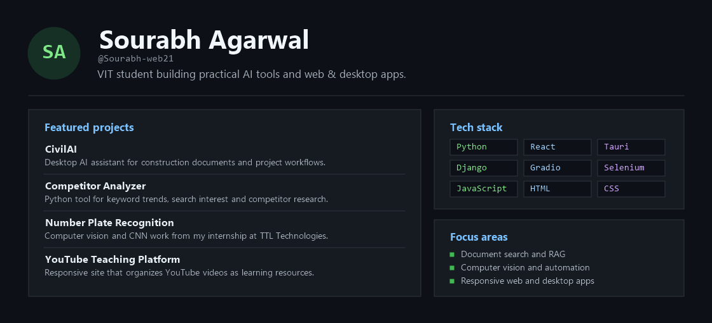

<p align="center">
  
</p>

```text
is2rAAsA22AXs2AXX3XAXrsXriiririXs;,rsrrA;,,.,;irsAAAsiirr;is
rXhrArsXsrsriXrX252252Xrrriii.;;ri,;iiiXX::,,,;iirrXAssrisXs
ii5rirrrr;rAiXsi;;ssrXs:....,..,::;;;isX5X:,,,;rsssi5Xi2X23A
ssh5rssXii;ssrX2X:i: ..,,,.   .,,,:;;irX55r,.;irssrrXXX52A2X
si325i2s;ii;iiXr:..   ..,,::,....,,::::::iXi:r;rssiis255sX3X
;:XX3sX:,.,;i;...        ...,,,,.,::;;;::;irXr;:rsrX2235A53A
XXis:53r;,,.  ,.        .,,,,,,::,,,,:::;ii;,ii;;irs5sshH5h3
Xi::,AX:;,.     .   .....,,,,,:;iirsssrii;::..,;;irX2Ai5M3MM
:,:iss:::  ..         .,:;;;irA3MHGSSSSGGMA;,:;:;rXXAAs2M3hG
,,,ri:;:..,.         .:rA5hMHS##9999#99999#MX;ii;XAXXA;sh3MS
;;;:;:i, ..        .iAhHGS#99999999999999BB9G5sAX2isX2:;MMhG
sXAXXXAr  ..      ,s3HS####99999999999#99B&&B#M525;,r5i;3hHH
AAXX555A; .      :X3MHGS##########9999999B&@@@#h25i,i2r:A3GH
sss2HGH#h     .,i23hMHHSS#######9BB9#GMh33GB@@&MA2r,rXi:r5HH
s5GG#S#&AM;  .iX25hMHGGS#99999##Hh2XsssA3MMS&@@MAs3GhXr:i5HM
523MhhMGrGH  .iA25AXXXXXXA3G###G2AXssX53MHG#B@@HXHBB#5i:i3Mh
2hhMHMMSiH9;  iAAr,:;;;;::iXhG#9SGM5MXiXG35HSB@B5BBB9Mi;i5hh
23GGGH53isXr. ,AAsAAXXisAM5AXhS9#SSHGH3M######B@SS#SBM;;rhh5
5G#HSMAXisr22: X5AArr3Xi5SH35hHS##S#SSS######9B&&#BSBM:;232s
3###HXr5;2rA25:r325333hhMMMhhhHS###S#9##S##99B&@&9##Bhirh32r
3#H332r5;irA3hA;hhMHHHGGGHGM3hG#99#S###S#9999B&@@#99&MA5A2As
9A2XsArAX5Xs5M3A5hHHGGGGS#HhM32hSSGGGS##S#9999&@&S##G2ssA2Ar
SX35X#3ri52r5h3223MGSSS#99G33225hMMhhHGGMMG#99&&BSh3A2XisM2s
;isM9@BXX3MG353h223MGSS##SHM525hhMMMMHMh2sXG99BBBSh3AAXi;25A
sX2hGH#s5#GGhX5Mh2A5hHGGh2XXA23hhMHHGHHMHH3G9#999M532XXi;sMH
222Xrs5siXh5h2s2XirA2hHH2ssrsA5hHGHHGGS#99GS99B9SM232sAr:sh3
5h2sXA5riX55AAsXi.:ssX23M33h5255333hG#999##S99SGB#222AhX:rAX
Xh5AAs5iA3XAA2ss;:,rArsA5323hMMHHGS#99#SSS#GMhH9&BHhs5HA,iXX
5h35sXGiAAAs55si.:srXArrsssX23hhhG#SSSGMMh55MS99B&hBM2MX,;X2
3hh3AAh;AAXrirr:.,XMArrrri;;iirXX235AAsX23H###999&HM@MA5,;s3
XhM2X23;3AXr25i..XhSG5rs5ssri;;;iiirrX5HS99###99993G@@2s2XX3
X3M3222i352MSXr:;GB9B9;2GX222AXsXA5MHS##S#####999G5@@@BiA353
3MMhM5A;AA253hXX59BBHs h&hAhhh3253hMG####SS##99#S5S@@@@Ar255
MSh2hHAi2XsA#Mr3G&Ms:,.HB923MMMMhhMMHGS########Sh3@@@@@2iX52
```

<p align="center">
  <a href="https://sourabh2005.vercel.app/">Portfolio</a> ·
  <a href="https://www.linkedin.com/in/sourabh-agarwal-41b13b301/">LinkedIn</a> ·
  <a href="mailto:sourabh.agarwal2023@vitstudent.ac.in">Email</a> ·
  <a href="https://github.com/Sourabh-web21#js-contribution-activity">GitHub activity</a>
</p>

[](https://github.com/Sourabh-web21#js-contribution-activity)

### Projects

| Project | What it does |
| --- | --- |
| [CivilAI](https://github.com/Sourabh-web21/Civilai) | Desktop AI assistant for construction documents and project workflows. [Windows and macOS downloads](https://github.com/Sourabh-web21/Civilai/releases/tag/v0.1.0) |
| [Competitor Analyzer](https://github.com/Sourabh-web21/Competitor-Analyser) | Tracks keyword trends, search interest and competitor visibility. |
| [Number Plate Recognition](https://github.com/Sourabh-web21/Number-Plate-Reading-Machine) | Computer vision and CNN work from my internship at TTL Technologies. |
| [YouTube Teaching Platform](https://github.com/Sourabh-web21/Youtube_Teach_Platform) | Organizes YouTube videos as learning resources. |

**Tech stack** · Python, JavaScript, React, Tauri, Django, Gradio, Selenium, HTML and CSS
